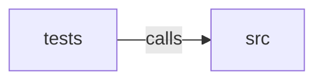

_Generated by CodeAtlas._

## Details

Owns 0 symbols across 1 file(s).

### src

Owns 8 symbols across 3 file(s).

**Related Classes/Methods:** _None_

**Source Files:**

- `crates/browser/src/error.rs`
  - `crates.browser.src.error.BrowserError`
- `crates/browser/src/renderer.rs`
  - `crates.browser.src.renderer.BrowserRenderer`
  - `crates.browser.src.renderer.BrowserRenderer.launch`
  - `crates.browser.src.renderer.BrowserRenderer.render`
  - `crates.browser.src.renderer.CookieRecord`
  - `crates.browser.src.renderer.NetworkRequestRecord`
  - `crates.browser.src.renderer.RenderedPage`
  - `crates.browser.src.renderer.ensure_executable`

### tests

Owns 1 symbols across 1 file(s).

**Related Classes/Methods:** _None_

**Source Files:**

- `crates/browser/tests/render.rs`
  - `crates.browser.tests.render.renders_js_injected_content_and_captures_the_fetch_it_fires`
