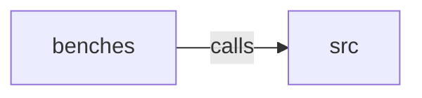

_Generated by CodeAtlas._

## Details

Owns 0 symbols across 1 file(s).

### benches

Owns 1 symbols across 1 file(s).

**Related Classes/Methods:** _None_

**Source Files:**

- `crates/core/benches/normalize.rs`
  - `crates.core.benches.normalize.bench_normalize`

### src

Owns 33 symbols across 5 file(s).

**Related Classes/Methods:** _None_

**Source Files:**

- `crates/core/src/config.rs`
  - `crates.core.src.config.CrawlConfig`
  - `crates.core.src.config.CrawlConfig.default`
- `crates/core/src/error.rs`
  - `crates.core.src.error.CoreError`
- `crates/core/src/normalize.rs`
  - `crates.core.src.normalize.NormalizationOptions`
  - `crates.core.src.normalize.NormalizationOptions.default`
  - `crates.core.src.normalize.TrailingSlashPolicy`
  - `crates.core.src.normalize.apply_trailing_slash_policy`
  - `crates.core.src.normalize.collapse_slashes`
  - `crates.core.src.normalize.default_tracking_params`
  - `crates.core.src.normalize.fingerprint`
  - `crates.core.src.normalize.has_file_extension`
  - `crates.core.src.normalize.normalize_url`
  - `crates.core.src.normalize.rewrite_query`
  - `crates.core.src.normalize.tests.collapses_duplicate_slashes`
  - `crates.core.src.normalize.tests.fingerprint_is_stable_and_normalization_sensitive`
  - `crates.core.src.normalize.tests.keeps_nonstandard_port`
  - `crates.core.src.normalize.tests.lowercases_host`
  - `crates.core.src.normalize.tests.opts`
  - `crates.core.src.normalize.tests.preserves_content_identity_query_params`
  - `crates.core.src.normalize.tests.sort_query_params_when_enabled`
  - `crates.core.src.normalize.tests.strips_default_port`
  - `crates.core.src.normalize.tests.strips_fragment`
  - `crates.core.src.normalize.tests.strips_tracking_params_but_keeps_others`
- `crates/core/src/types.rs`
  - `crates.core.src.types.CrawlErrorRecord`
  - `crates.core.src.types.CrawlResult`
  - `crates.core.src.types.CrawlStats`
  - `crates.core.src.types.CrawlStats.throughput_per_sec`
  - `crates.core.src.types.FetchMethod`
  - `crates.core.src.types.Link`
  - `crates.core.src.types.Page`
  - `crates.core.src.types.PageMetadata`
  - `crates.core.src.types.UrlRecord`
  - `crates.core.src.types.UrlStatus`
