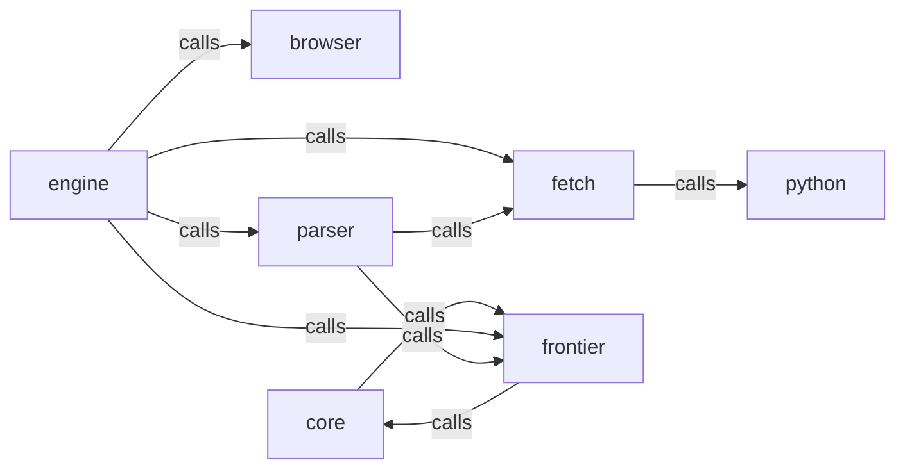

_Generated by CodeAtlas._

## Details

Owns 0 symbols across 0 file(s).

### browser

Owns 0 symbols across 1 file(s).

**Related Classes/Methods:** _None_

### core

Owns 0 symbols across 1 file(s).

**Related Classes/Methods:** _None_

### engine

Owns 0 symbols across 1 file(s).

**Related Classes/Methods:** _None_

### fetch

Owns 0 symbols across 1 file(s).

**Related Classes/Methods:** _None_

### frontier

Owns 0 symbols across 1 file(s).

**Related Classes/Methods:** _None_

### parser

Owns 0 symbols across 1 file(s).

**Related Classes/Methods:** _None_

### python

Owns 0 symbols across 4 file(s).

**Related Classes/Methods:** _None_
