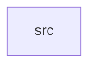

_Generated by CodeAtlas._

## Details

Owns 0 symbols across 1 file(s).

### src

Owns 6 symbols across 1 file(s).

**Related Classes/Methods:** _None_

**Source Files:**

- `crates/engine/src/lib.rs`
  - `crates.engine.src.lib.StatsCounter`
  - `crates.engine.src.lib.crawl`
  - `crates.engine.src.lib.read_scope_host`
  - `crates.engine.src.lib.render_target_is_blocked`
  - `crates.engine.src.lib.tests.scope_host_lock_recovers_from_poisoning_instead_of_panicking`
  - `crates.engine.src.lib.update_scope_host`
