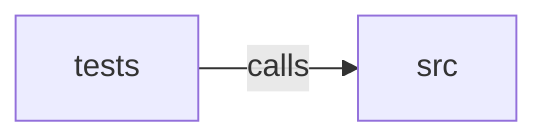

_Generated by CodeAtlas._

## Details

Owns 0 symbols across 1 file(s).

### src

Owns 97 symbols across 9 file(s).

**Related Classes/Methods:** _None_

**Source Files:**

- `crates/fetch/src/challenge.rs`
  - `crates.fetch.src.challenge.ChallengeSignal`
  - `crates.fetch.src.challenge.detect_challenge`
  - `crates.fetch.src.challenge.tests.marker_far_beyond_the_scan_window_is_not_detected`
  - `crates.fetch.src.challenge.tests.ordinary_200_page_is_not_flagged`
  - `crates.fetch.src.challenge.tests.ordinary_404_is_not_flagged`
  - `crates.fetch.src.challenge.tests.status_200_with_challenge_marker_is_flagged`
  - `crates.fetch.src.challenge.tests.status_403_is_blocked_regardless_of_body`
  - `crates.fetch.src.challenge.tests.status_429_is_rate_limited_regardless_of_body`
- `crates/fetch/src/error.rs`
  - `crates.fetch.src.error.FetchError`
- `crates/fetch/src/fetcher.rs`
  - `crates.fetch.src.fetcher.ClientSet`
  - `crates.fetch.src.fetcher.FetchResponse`
  - `crates.fetch.src.fetcher.FetchResponse.header`
  - `crates.fetch.src.fetcher.HttpFetcher`
  - `crates.fetch.src.fetcher.HttpFetcher.current_proxy_index`
  - `crates.fetch.src.fetcher.HttpFetcher.fetch`
  - `crates.fetch.src.fetcher.HttpFetcher.fetch_once`
  - `crates.fetch.src.fetcher.HttpFetcher.new`
  - `crates.fetch.src.fetcher.ProxyPool`
  - `crates.fetch.src.fetcher.ProxyPool.index`
  - `crates.fetch.src.fetcher.ProxyPool.mark_failure`
  - `crates.fetch.src.fetcher.ProxyPool.new`
  - `crates.fetch.src.fetcher.ProxyPool.select`
  - `crates.fetch.src.fetcher.backoff_delay`
  - `crates.fetch.src.fetcher.build_client`
  - `crates.fetch.src.fetcher.build_header_map`
  - `crates.fetch.src.fetcher.is_retryable_error`
  - `crates.fetch.src.fetcher.is_retryable_status`
  - `crates.fetch.src.fetcher.parse_retry_after`
  - `crates.fetch.src.fetcher.read_body_capped`
  - `crates.fetch.src.fetcher.tests.backoff_grows_and_caps`
  - `crates.fetch.src.fetcher.tests.build_header_map_accepts_valid_headers`
  - `crates.fetch.src.fetcher.tests.build_header_map_rejects_invalid_name`
  - `crates.fetch.src.fetcher.tests.build_header_map_rejects_invalid_value`
  - `crates.fetch.src.fetcher.tests.direct_fetcher_reports_proxy_index_zero`
  - `crates.fetch.src.fetcher.tests.dummy_clients`
  - `crates.fetch.src.fetcher.tests.fetcher_builds_a_pool_from_configured_proxies`
  - `crates.fetch.src.fetcher.tests.fetcher_rejects_invalid_proxy_url`
  - `crates.fetch.src.fetcher.tests.proxy_pool_mark_failure_rotates_immediately`
  - `crates.fetch.src.fetcher.tests.proxy_pool_rotates_after_configured_requests`
  - `crates.fetch.src.fetcher.tests.retry_after_parses_seconds`
  - `crates.fetch.src.fetcher.tests.retryable_statuses`
- `crates/fetch/src/health.rs`
  - `crates.fetch.src.health.CircuitState`
  - `crates.fetch.src.health.DomainHealthTracker`
  - `crates.fetch.src.health.DomainHealthTracker.default`
  - `crates.fetch.src.health.DomainHealthTracker.is_available`
  - `crates.fetch.src.health.DomainHealthTracker.new`
  - `crates.fetch.src.health.DomainHealthTracker.record_response`
  - `crates.fetch.src.health.DomainHealthTracker.snapshot`
  - `crates.fetch.src.health.DomainStats`
  - `crates.fetch.src.health.DomainStats.cooldown_remaining`
  - `crates.fetch.src.health.DomainStats.new`
  - `crates.fetch.src.health.tests.a_success_in_between_resets_the_consecutive_counter`
  - `crates.fetch.src.health.tests.cooldown_doubles_on_repeated_opens`
  - `crates.fetch.src.health.tests.half_open_failure_reopens_immediately`
  - `crates.fetch.src.health.tests.half_opens_after_cooldown_then_recloses_on_success`
  - `crates.fetch.src.health.tests.opens_after_threshold_consecutive_429s`
  - `crates.fetch.src.health.tests.plain_404s_never_open_the_circuit`
  - `crates.fetch.src.health.tests.tracker`
  - `crates.fetch.src.health.tests.unknown_host_is_available`
- `crates/fetch/src/politeness.rs`
  - `crates.fetch.src.politeness.PolitenessManager`
  - `crates.fetch.src.politeness.PolitenessManager.host_semaphore`
  - `crates.fetch.src.politeness.PolitenessManager.new`
  - `crates.fetch.src.politeness.PolitenessManager.wait_for_slot`
- `crates/fetch/src/robots.rs`
  - `crates.fetch.src.robots.CachedRobots`
  - `crates.fetch.src.robots.RobotsManager`
  - `crates.fetch.src.robots.RobotsManager.fetch_and_parse`
  - `crates.fetch.src.robots.RobotsManager.is_allowed`
  - `crates.fetch.src.robots.RobotsManager.new`
- `crates/fetch/src/security.rs`
  - `crates.fetch.src.security.SsrfGuardResolver`
  - `crates.fetch.src.security.SsrfGuardResolver.resolve`
  - `crates.fetch.src.security.ip_literal_is_blocked`
  - `crates.fetch.src.security.is_benchmark_v4`
  - `crates.fetch.src.security.is_blocked_ip`
  - `crates.fetch.src.security.is_blocked_v4`
  - `crates.fetch.src.security.is_blocked_v6`
  - `crates.fetch.src.security.is_cgnat_v4`
  - `crates.fetch.src.security.is_documentation_v6`
  - `crates.fetch.src.security.is_reserved_v4`
  - `crates.fetch.src.security.is_unique_local_v6`
  - `crates.fetch.src.security.tests.allows_public_v4`
  - `crates.fetch.src.security.tests.allows_public_v4_just_outside_blocked_ranges`
  - `crates.fetch.src.security.tests.allows_public_v6`
  - `crates.fetch.src.security.tests.blocks_cgnat_benchmark_and_reserved_v4`
  - `crates.fetch.src.security.tests.blocks_cloud_metadata_endpoint`
  - `crates.fetch.src.security.tests.blocks_documentation_v6`
  - `crates.fetch.src.security.tests.blocks_loopback_and_private_v4`
  - `crates.fetch.src.security.tests.blocks_loopback_v6_and_ula`
  - `crates.fetch.src.security.tests.blocks_v4_mapped_private_v6`
  - `crates.fetch.src.security.tests.ip_literal_hosts_are_checked`
- `crates/fetch/src/status.rs`
  - `crates.fetch.src.status.CrawlStatus`
  - `crates.fetch.src.status.CrawlStatus.fmt`
  - `crates.fetch.src.status.classify_status`
  - `crates.fetch.src.status.tests.plain_404_with_no_challenge_signal_is_failed`
  - `crates.fetch.src.status.tests.plain_server_error_with_no_challenge_signal_is_failed`
  - `crates.fetch.src.status.tests.rate_limited_signal_wins_over_status`
  - `crates.fetch.src.status.tests.redirect_status_counts_as_success`
  - `crates.fetch.src.status.tests.success_status_with_no_challenge_signal`

### tests

Owns 12 symbols across 1 file(s).

**Related Classes/Methods:** _None_

**Source Files:**

- `crates/fetch/tests/http_fetcher.rs`
  - `crates.fetch.tests.http_fetcher.blocks_ip_literal_hosts_without_touching_network`
  - `crates.fetch.tests.http_fetcher.default_headers_are_sent_with_every_request`
  - `crates.fetch.tests.http_fetcher.describe`
  - `crates.fetch.tests.http_fetcher.fetches_basic_page`
  - `crates.fetch.tests.http_fetcher.gives_up_after_max_retries_on_persistent_500`
  - `crates.fetch.tests.http_fetcher.invalid_default_header_name_fails_fetcher_construction`
  - `crates.fetch.tests.http_fetcher.missing_robots_txt_allows_everything`
  - `crates.fetch.tests.http_fetcher.politeness_manager_spaces_out_requests`
  - `crates.fetch.tests.http_fetcher.response_over_max_size_is_rejected`
  - `crates.fetch.tests.http_fetcher.retries_on_503_then_succeeds`
  - `crates.fetch.tests.http_fetcher.robots_disallow_blocks_matching_path`
  - `crates.fetch.tests.http_fetcher.test_config`
