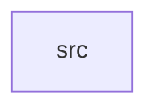

_Generated by CodeAtlas._

## Details

Owns 0 symbols across 1 file(s).

### src

Owns 25 symbols across 4 file(s).

**Related Classes/Methods:** _None_

**Source Files:**

- `crates/frontier/src/frontier.rs`
  - `crates.frontier.src.frontier.Frontier`
  - `crates.frontier.src.frontier.Frontier.complete`
  - `crates.frontier.src.frontier.Frontier.is_stopped`
  - `crates.frontier.src.frontier.Frontier.new`
  - `crates.frontier.src.frontier.Frontier.pending`
  - `crates.frontier.src.frontier.Frontier.pop`
  - `crates.frontier.src.frontier.Frontier.queued_len`
  - `crates.frontier.src.frontier.Frontier.stop`
  - `crates.frontier.src.frontier.Frontier.try_push`
  - `crates.frontier.src.frontier.Frontier.visited_count`
  - `crates.frontier.src.frontier.tests.duplicate_urls_are_rejected`
  - `crates.frontier.src.frontier.tests.frontier`
  - `crates.frontier.src.frontier.tests.futures_join_all`
  - `crates.frontier.src.frontier.tests.normalization_collapses_dedup_key`
  - `crates.frontier.src.frontier.tests.poisoned_queue_lock_is_recovered_not_propagated`
  - `crates.frontier.src.frontier.tests.shallower_depth_pops_first`
  - `crates.frontier.src.frontier.tests.stop_wakes_blocked_workers_immediately`
  - `crates.frontier.src.frontier.tests.workers_terminate_when_drained`
- `crates/frontier/src/item.rs`
  - `crates.frontier.src.item.FrontierItem`
  - `crates.frontier.src.item.FrontierItem.cmp`
  - `crates.frontier.src.item.FrontierItem.eq`
  - `crates.frontier.src.item.FrontierItem.partial_cmp`
- `crates/frontier/src/scheduler.rs`
  - `crates.frontier.src.scheduler.DepthPriority`
  - `crates.frontier.src.scheduler.DepthPriority.score`
  - `crates.frontier.src.scheduler.PriorityScorer`
