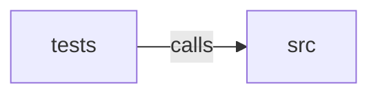

_Generated by CodeAtlas._

## Details

Owns 0 symbols across 1 file(s).

### src

Owns 11 symbols across 5 file(s).

**Related Classes/Methods:** _None_

**Source Files:**

- `apps/mudfish/src/cli.rs`
  - `apps.mudfish.src.cli.Cli`
  - `apps.mudfish.src.cli.Command`
  - `apps.mudfish.src.cli.CrawlArgs`
  - `apps.mudfish.src.cli.OutputFormat`
- `apps/mudfish/src/crawl.rs`
  - `apps.mudfish.src.crawl.build_config`
  - `apps.mudfish.src.crawl.execute`
  - `apps.mudfish.src.crawl.run`
- `apps/mudfish/src/main.rs`
  - `apps.mudfish.src.main.main`
- `apps/mudfish/src/output.rs`
  - `apps.mudfish.src.output.emit`
  - `apps.mudfish.src.output.format_bytes`
  - `apps.mudfish.src.output.write_summary`

### tests

Owns 6 symbols across 1 file(s).

**Related Classes/Methods:** _None_

**Source Files:**

- `apps/mudfish/tests/crawl.rs`
  - `apps.mudfish.tests.crawl.args_for`
  - `apps.mudfish.tests.crawl.dedups_links_reachable_by_multiple_paths`
  - `apps.mudfish.tests.crawl.follows_same_domain_links_up_to_depth`
  - `apps.mudfish.tests.crawl.html_response`
  - `apps.mudfish.tests.crawl.max_urls_is_a_hard_cap_under_concurrency`
  - `apps.mudfish.tests.crawl.same_domain_scoping_follows_seed_redirect`
