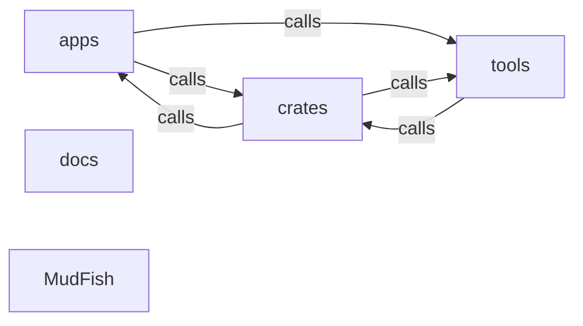

_Generated by CodeAtlas._

## Details

Architecture map of MudFish.

### apps

Owns 0 symbols across 0 file(s).

**Related Classes/Methods:** _None_

### crates

Owns 0 symbols across 0 file(s).

**Related Classes/Methods:** _None_

### docs

Owns 0 symbols across 0 file(s).

**Related Classes/Methods:** _None_

### tools

Owns 3 symbols across 1 file(s).

**Related Classes/Methods:** _None_

**Source Files:**

- `tools/fetch_chrome_headless_shell.py`
  - `tools.fetch_chrome_headless_shell.default_platform`
  - `tools.fetch_chrome_headless_shell.main`
  - `tools.fetch_chrome_headless_shell.resolve_download`

### MudFish

Owns 0 symbols across 12 file(s).

**Related Classes/Methods:** _None_
