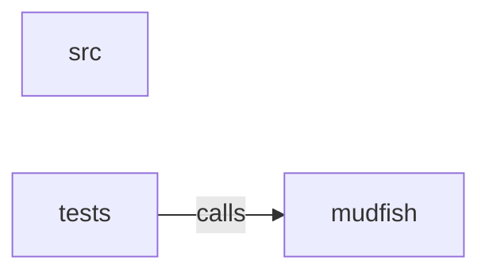

_Generated by CodeAtlas._

## Details

Owns 0 symbols across 4 file(s).

### mudfish

Owns 44 symbols across 2 file(s).

**Related Classes/Methods:** _None_

**Source Files:**

- `crates/python/python/mudfish/__init__.py`
  - `crates.python.python.mudfish.__init__.CrawlError`
  - `crates.python.python.mudfish.__init__.CrawlFailedError`
  - `crates.python.python.mudfish.__init__.CrawlOptions`
  - `crates.python.python.mudfish.__init__.CrawlOptions.as_kwargs`
  - `crates.python.python.mudfish.__init__.CrawlOptions.from_kwargs`
  - `crates.python.python.mudfish.__init__.CrawlResult`
  - `crates.python.python.mudfish.__init__.CrawlResult.__iter__`
  - `crates.python.python.mudfish.__init__.CrawlResult.__len__`
  - `crates.python.python.mudfish.__init__.CrawlResult.ok_pages`
  - `crates.python.python.mudfish.__init__.CrawlStats`
  - `crates.python.python.mudfish.__init__.CrawlStats.duration_secs`
  - `crates.python.python.mudfish.__init__.CrawlStats.throughput_per_sec`
  - `crates.python.python.mudfish.__init__.Crawler`
  - `crates.python.python.mudfish.__init__.Crawler.__init__`
  - `crates.python.python.mudfish.__init__.Crawler.__repr__`
  - `crates.python.python.mudfish.__init__.Crawler.crawl`
  - `crates.python.python.mudfish.__init__.Crawler.crawl_async`
  - `crates.python.python.mudfish.__init__.Crawler.crawl_dict`
  - `crates.python.python.mudfish.__init__.FetchMethod`
  - `crates.python.python.mudfish.__init__.FetchMethod._from_raw`
  - `crates.python.python.mudfish.__init__.InvalidURLError`
  - `crates.python.python.mudfish.__init__.Link`
  - `crates.python.python.mudfish.__init__.MudfishError`
  - `crates.python.python.mudfish.__init__.Page`
  - `crates.python.python.mudfish.__init__.Page.is_ok`
  - `crates.python.python.mudfish.__init__.Page.title`
  - `crates.python.python.mudfish.__init__.PageMetadata`
  - `crates.python.python.mudfish.__init__._AsDict`
  - `crates.python.python.mudfish.__init__._AsDict.__contains__`
  - `crates.python.python.mudfish.__init__._AsDict.__getitem__`
  - `crates.python.python.mudfish.__init__._AsDict.get`
  - `crates.python.python.mudfish.__init__._AsDict.items`
  - `crates.python.python.mudfish.__init__._AsDict.keys`
  - `crates.python.python.mudfish.__init__._AsDict.to_dict`
  - `crates.python.python.mudfish.__init__._AsDict.values`
  - `crates.python.python.mudfish.__init__._as_raw`
  - `crates.python.python.mudfish.__init__._parse_link`
  - `crates.python.python.mudfish.__init__._parse_page`
  - `crates.python.python.mudfish.__init__._parse_result`
  - `crates.python.python.mudfish.__init__._run_raw`
  - `crates.python.python.mudfish.__init__.bundled_chrome_path`
  - `crates.python.python.mudfish.__init__.crawl`
  - `crates.python.python.mudfish.__init__.crawl_async`
  - `crates.python.python.mudfish.__init__.crawl_dict`

### src

Owns 2 symbols across 1 file(s).

**Related Classes/Methods:** _None_

**Source Files:**

- `crates/python/src/lib.rs`
  - `crates.python.src.lib._mudfish`
  - `crates.python.src.lib.crawl`

### tests

Owns 17 symbols across 1 file(s).

**Related Classes/Methods:** _None_

**Source Files:**

- `crates/python/tests/test_crawl.py`
  - `crates.python.tests.test_crawl._Handler`
  - `crates.python.tests.test_crawl._Handler.do_GET`
  - `crates.python.tests.test_crawl._Handler.log_message`
  - `crates.python.tests.test_crawl.server`
  - `crates.python.tests.test_crawl.test_basic_crawl_returns_expected_shape`
  - `crates.python.tests.test_crawl.test_crawl_async`
  - `crates.python.tests.test_crawl.test_crawl_dict_returns_plain_dict`
  - `crates.python.tests.test_crawl.test_crawler_reuses_options`
  - `crates.python.tests.test_crawl.test_follows_same_domain_links`
  - `crates.python.tests.test_crawl.test_invalid_url_raises_custom_error`
  - `crates.python.tests.test_crawl.test_invalid_url_raises_value_error`
  - `crates.python.tests.test_crawl.test_render_options_are_forwarded`
  - `crates.python.tests.test_crawl.test_result_is_iterable_over_pages`
  - `crates.python.tests.test_crawl.test_returns_typed_result`
  - `crates.python.tests.test_crawl.test_ssrf_guard_blocks_loopback_by_default`
  - `crates.python.tests.test_crawl.test_typed_result_still_supports_dict_access`
  - `crates.python.tests.test_crawl.test_unknown_option_raises_type_error`
